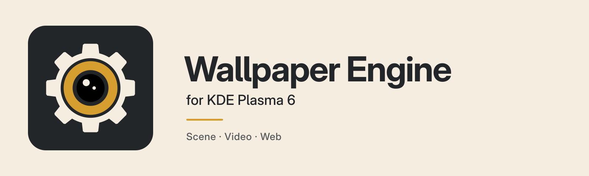
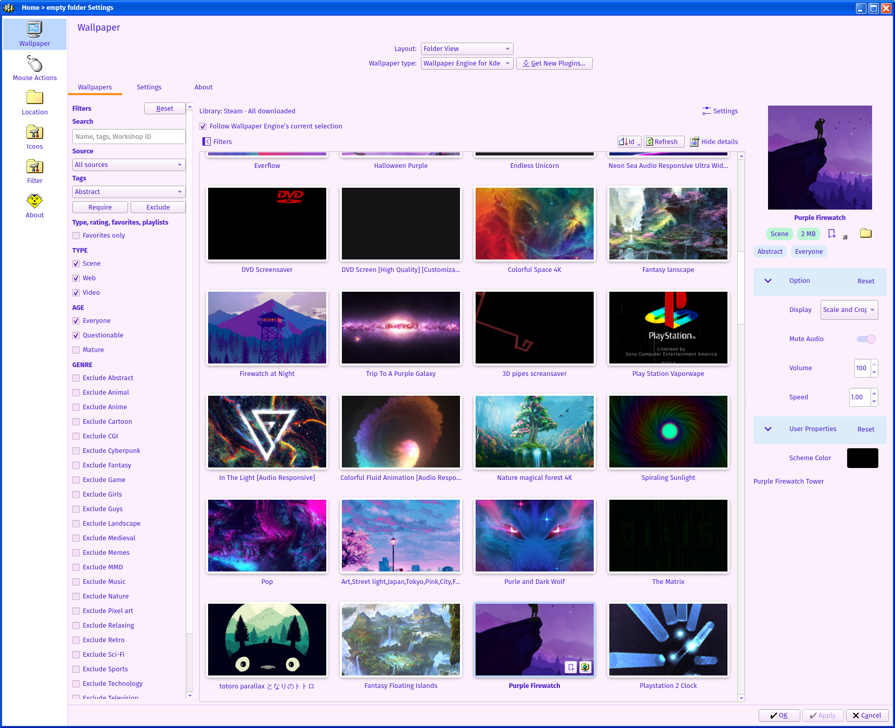
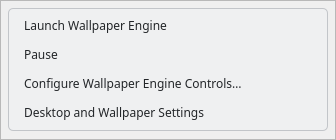

# Wallpaper Engine for KDE



Play Wallpaper Engine scene, video and web wallpapers on KDE Plasma 6.
This is [Plaer1’s fork](https://github.com/Plaer1/wallpaper-engine-kde-plugin) of
[RainyPixel’s plugin](https://github.com/RainyPixel/wallpaper-engine-kde-plugin),
originally based on [catsout’s work](https://github.com/catsout/wallpaper-engine-kde-plugin).
Wallpaper Engine and its wallpapers are installed separately through Steam.

This fork adds Steam library/account discovery, following Wallpaper Engine’s saved
selection, a searchable wallpaper browser, shared audio/sizing controls, and a tray
menu with pause/resume and a global shortcut.

[](docs/images/wallpaper-browser.png)

*Live wallpaper browser with a custom Plasma theme. The plugin follows your desktop’s appearance.*

## Requirements

- KDE Plasma 6; Qt 6.7 or newer; a working Vulkan 1.1 driver for scene wallpapers.
- Wallpaper Engine installed through Steam, with wallpapers downloaded locally.
- For building: a C++20 compiler, CMake, Ninja, extra-cmake-modules, Plasma/KF6
  development files, Qt Quick/QML and Qt GUI private headers, libmpv, LZ4 and Vulkan headers.
- At runtime: Kirigami, KCMUtils, Qt Quick Controls/Layouts, Qt5Compat GraphicalEffects,
  Qt WebEngine/WebChannel and Qt Multimedia. Available video codecs depend on the backend.

The separate [Hyprland host](hyprland/README.md) has its own build and currently
supports web wallpapers only. The instructions below install the KDE plugin.

## Build and install

On Arch Linux:

```sh
sudo pacman -S --needed base-devel git cmake ninja extra-cmake-modules \
  libplasma plasma-desktop kglobalaccel kxmlgui kirigami kcmutils \
  mpv lz4 vulkan-headers qt6-base qt6-declarative \
  qt6-webchannel qt6-webengine qt6-multimedia qt6-5compat \
  gst-libav gst-plugins-good gst-plugin-pipewire
```

Clone the fork’s working branch and build:

```sh
git clone --recurse-submodules --branch clanker/steam-library-picker \
  https://github.com/Plaer1/wallpaper-engine-kde-plugin.git
cd wallpaper-engine-kde-plugin
cmake -S . -B build -G Ninja -DCMAKE_BUILD_TYPE=Release
cmake --build build --parallel
sudo cmake --install build
```

For an existing checkout, run `git submodule update --init --recursive` before
building. Save any open desktop-settings edits, then reload Plasma:

```sh
systemctl --user restart plasma-plasmashell.service
```

[Fedora/RPM instructions](rpm/README.md) are available separately. This fork’s recent
build and desktop checks were on Arch Linux with Plasma 6/Wayland; other distributions
and multi-monitor combinations have not all been validated. Packages from upstream
or third parties may contain different changes from this fork.

## Choose wallpapers

1. Right-click the desktop → **Desktop and Wallpaper Settings**.
2. Select **Wallpaper Engine for Kde** as the wallpaper type.
3. Single-click a wallpaper to preview/stage it; **Apply** saves the selection.
   Double-click applies it immediately and keeps unrelated settings edits pending.

Steam libraries are detected automatically, including native, Flatpak and Snap
locations and libraries on other drives. One library is selected automatically;
open the browser’s **Settings** disclosure to choose another, **Rescan**, or **Browse…**.
Choose the library folder containing `steamapps`.

The collapsible left sidebar contains search, tag inclusion/exclusion, source,
type, age-rating, favorite and playlist filters. Search matches names, tags and
Workshop IDs. Account scope chooses all downloaded wallpapers or selected accounts’
subscriptions, with an option to include local/shared projects. The right inspector
can be resized or hidden. Filters use cached metadata; new downloads are detected
through filesystem notifications.

## Follow Wallpaper Engine

Enable **Follow Wallpaper Engine’s current selection**, choose the account/source,
and click **Apply** once. Subsequent saved selections in Wallpaper Engine update the
desktop without reopening KDE settings. Browse scope and the followed account are
separate choices. Use an explicit account/source; the active Proton account is not
automatically inferred. An unassociated legacy section can be mapped to a verified
account through the source picker’s confirmation step.

If Proton’s Wallpaper Engine UI does not save an applied selection, install the
optional bridge with Python 3. Adjust the path for your Steam library:

```sh
python3 tools/install-we-selection-bridge.py \
  "$HOME/.local/share/Steam/steamapps/common/wallpaper_engine"
```

Reopen Wallpaper Engine’s wallpaper browser and select a downloaded wallpaper.
The bridge modifies its UI files, backs up the entry point, and records browser
selections by account. Rerun the installer after Steam updates/verifies those files;
add `--remove` to remove it. Following prefers native applied selections when present.
Both paths use change notifications rather than recurring file polling.

Following reads saved selections, not unsaved playlist playback or wallpaper-property
edits. Unavailable wallpapers leave the last working background in place. Random
rotation is suspended while following. A manual double-click selection stops Follow;
disabling Follow returns to the manual KDE selection.

## Tray and playback

Enable **Wallpaper Engine Controls** in the system tray settings. Set its visibility
to **Always shown** if you want it outside the overflow popup. Its menus provide:

- **Launch Wallpaper Engine** — first item; opens `steam://rungameid/431960`.
- **Pause / Resume** — controls all registered wallpaper screens.
- **Configure Controls** — includes the global pause/resume shortcut.
- **Desktop and Wallpaper Settings** — opens the KDE wallpaper configuration.



*Compact tray menu, rendered from the applet’s controls in a light theme.*

Under **Settings → Playback**, choose the primary-monitor window rule: mostly covered
(including tiled windows), focused, maximized, focused or maximized, any window, or
fullscreen only. The selected rule pauses all wallpaper screens. Visible fullscreen apps on
any screen also pause all wallpapers in automatic mode. Tray Resume temporarily
bypasses window/fullscreen pauses; it does not bypass battery or game-mode rules.
The override lasts until another playback command or the session ends. Resume delay
applies after the primary-monitor window rule clears and is disabled for fullscreen-only mode.

**Mute all wallpapers** and **Global sizing** act across screens independently of
shared wallpaper mode. Sizing offers **Fill (crop)** and **Stretch** for scene/video
wallpapers; web pages control their own layout. Master mute disables or detaches audio
where supported; some web media still needs Chromium’s output-mute fallback.

**Same wallpaper on all screens** shares wallpaper settings. **Span Across Screens**
lays out a wallpaper across the desktop bounds; use the same wallpaper/display mode
on each screen. Compatible scenes can share rendering through **Mirror scene across screens**.

## Limits and troubleshooting

- Scene compatibility is incomplete; some wallpapers can crash Plasma. Video inside
  scene `.tex` files is not played. Ordinary video wallpapers use Qt Multimedia or mpv.
- WebGL and some web audio APIs may not behave as in Wallpaper Engine on Windows.
- Lock-screen wallpapers are unsupported. Wallpaper mouse capture can interfere
  with desktop long-press actions.
- Shared-mode Next can report partial results. Mirrored/spanned and activity mappings
  need further multi-output validation. Runtime status reports dispatched playback
  policy, not independent confirmation of rendered frames.
- An open settings dialog observes same-process QML changes; arbitrary external file
  or C++ changes may require reopening it. Qt Multimedia reload does not confirm a first frame.

If an old user-installed plugin masks the system version, move aside
`~/.local/share/plasma/wallpapers/com.github.catsout.wallpaperEngineKde` and reload Plasma.
Keep the QML package and native module from the same build.

For a crash loop, stop Plasma before editing, back up
`~/.config/plasma-org.kde.plasma.desktop-appletsrc`, and clear the affected wallpaper’s
`WallpaperSource` and disable its `FollowWallpaperEngine` setting. Shared selections
may also be stored in `~/.config/wekde/global.json`; clear the offending source there
as well when shared mode is enabled. Restore a working selection before
reenabling Follow. Logs are available with:

```sh
journalctl --user -u plasma-plasmashell.service -b
```

[Report issues in this fork](https://github.com/Plaer1/wallpaper-engine-kde-plugin/issues)
with the commit, Plasma/Qt versions, session type, wallpaper ID/type, reproduction
steps and relevant logs. Remove personal paths and account identifiers before sharing.
For source installs, `build/install_manifest.txt` lists installed files to remove;
for packaged installs, use the package manager. Reload Plasma after removal.

## Development

Configure with `-DBUILD_TESTS=ON`, build, then run
`ctest --test-dir build --output-on-failure`. QML checks need Qt Quick Test and the
KDE QML modules. [Native QML integration checks](tests/integration/README.md) require
an isolated configuration directory because they write shared settings.

## License and credits

[GPL-2.0-or-later](https://spdx.org/licenses/GPL-2.0-or-later.html); see [LICENSE](LICENSE).
This preserves the upstream `GPLv2+` declaration. Copyright and credit remain with
upstream authors and contributors; this fork is maintained by Plaer1.
Bundled [third-party components](src/backend_scene/third_party) retain their own
licenses and notices. Thanks also to [RePKG](https://github.com/notscuffed/repkg).
Wallpaper Engine and wallpaper assets are separate works, not included with this plugin.
[Image sources and capture notes](docs/images/README.md).
